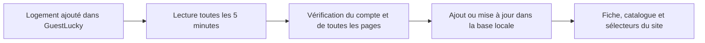

# GuestLucky : MCP et synchronisation automatique des logements

Mis en place et vérifié le **17 octobre 2026**, en environnement local.

## À quoi sert un MCP ?

MCP signifie **Model Context Protocol**. Ce protocole permet à un assistant IA de découvrir les outils d’une application et de les appeler avec des paramètres précis. Le serveur GuestLucky expose notamment des outils pour consulter les logements, les réservations, l’occupation et les missions. D’autres outils permettent des actions selon les droits du compte : créer une mission, modifier un logement, etc.

Exemples de demandes à un assistant connecté :

- « Liste mes logements. »
- « Quelle est mon occupation ce mois-ci ? »
- « Quelles missions de ménage sont prévues demain ? »

La validation d’une action dépend de l’assistant et de sa configuration. Une clé MCP n’est pas une garantie technique de confirmation à chaque écriture. L’intégration du site limite donc explicitement ses appels aux **deux outils de lecture** nécessaires.

Le MCP ne surveille pas spontanément les changements de GuestLucky et ne modifie pas automatiquement la base du site. Il faut un programme qui interroge le catalogue, compare les identifiants et enregistre les changements.

## Les trois connexions à distinguer

| Connexion | Utilité | Dans ce projet |
|---|---|---|
| Assistant ↔ MCP GuestLucky | Poser des questions et utiliser les outils autorisés | Connecteur GuestLucky disponible dans la conversation. |
| Symfony ↔ MCP GuestLucky | Ajouter et actualiser les fiches locales | Synchronisation toutes les cinq minutes, sans modèle IA. |
| Site ↔ Booking Engine GuestLucky | Lire les disponibilités et devis, poursuivre une réservation | Intégration existante avec une autre clé et ses propres contrôles. |

La **clé MCP privée** et la **clé Booking Engine** ne sont pas interchangeables.

## Ce qui fonctionne maintenant

L’accès au serveur `https://app.guestlucky.io/api/mcp` a été vérifié. Le propriétaire attendu est celui de **SAS Roaming** ; son identifiant est contrôlé avant tout import.

Le catalogue contient quatre logements à la date de vérification. Le nouveau bien, **L’Élégante Douaisienne • 4 Chambres**, situé à **Douai**, pour **8 voyageurs**, a été ajouté et activé dans la base locale :

```text
/property/l-elegante-douaisienne-4-chambres-2630
```

Ce chemin est un résultat d’import, pas un identifiant codé dans la logique métier.



Les changements apparaissent à la prochaine requête du site après synchronisation. Une page déjà ouverte peut nécessiter un rechargement.

## Données synchronisées et limites

La synchronisation utilise **uniquement** `gl-whoami` et `gl-list-properties`, sans filtre de nom, en lisant toutes les pages. Aucune création de réservation, mission, message ou autre donnée dans GuestLucky n’est effectuée.

Elle récupère l’identifiant GuestLucky, le nom public, la capacité, le minimum de nuits (`min_stay`), la ville et désormais l’adresse publique non vide. Quand aucun champ ville n’est exposé, celle-ci est extraite de la partie « code postal + commune » de l’adresse française. Si la commune est introuvable pour un nouveau logement, l’import échoue sans modifier la base. Une adresse absente ne supprime pas celle déjà connue. Les coordonnées vérifiées des quatre logements sont gérées séparément : un véritable changement d’adresse les invalide pour éviter un ancien repère. Voir [Emplacements et cartes](Property_locations_et_cartes.md) pour les sources et la mise à jour des coordonnées.

Le minimum est enregistré dans `property.minimum_stay` (migration `Version20261017220000`). Le 17 octobre, Lambersart, Roubaix et Croix indiquent deux nuits ; Douai ne fournit pas de minimum. Aucun minimum de deux nuits n’est imposé arbitrairement à tous les logements. La synchronisation peut actualiser ou effacer une restriction ; un ancien instantané sans ce champ conserve la valeur locale.

Le calendrier Booking Engine a annoncé une nuit le 23 octobre à Lambersart, alors que le MCP indique deux nuits et que le devis du 23 au 24 est refusé. Le site applique donc le plus grand minimum entre la fiche synchronisée et la règle de la date d’arrivée. Les calendriers d’accueil, de disponibilité et des fiches logement exigent suffisamment de nuits consécutives libres dans un même logement avant de proposer une arrivée. Un départ peut coïncider avec une nuit occupée, puisqu’elle n’est pas consommée. Les mois supplémentaires nécessaires à une arrivée en fin de mois sont chargés avant d’activer la sélection. Les devis restent soumis à GuestLucky pour les autres contraintes.

Validation : `php -d extension=pdo_sqlite bin/phpunit tests/GuestLucky`, `node --experimental-vm-modules tests/browser/calendar-rules.cjs`, `node tests/browser/minimum-stay.cjs` et `node tests/browser/booking-journey.cjs` (session équipe locale si maintenance active). Les tests simulent les réponses fournisseur ; ils ne créent aucune réservation.

Les correspondances reposent sur `guest_lucky_id`. Les slugs existants sont conservés : modifier un titre ne casse pas les liens. Les nouveaux slugs incluent un suffixe d’identifiant pour distinguer les logements portant le même nom.

Les descriptions, traductions, photos, avis et équipements existants sont préservés. **L’outil utilisé ne fournit pas les photos ni les descriptions** : une nouvelle fiche peut afficher « Photos à venir » jusqu’à l’ajout de ces contenus. Les chambres, lits et prestations ne sont pas déduits du titre.

Les tarifs et calendriers continuent à venir du Booking Engine. L’existence d’une fiche ne prouve pas que ses disponibilités et tarifs sont entièrement configurés. Pour Douai, plusieurs réglages de tarification et de séjour ne sont pas renseignés dans la réponse MCP observée ; aucun tarif n’a été inventé.

Un logement absent d’une lecture ultérieure n’est **pas désactivé automatiquement**. L’archivage reste une décision explicite. Une réponse vide, incomplète, dupliquée ou liée à un autre compte est rejetée ; le dernier catalogue local reste disponible.

## Configuration privée

La clé fournie a été enregistrée uniquement dans `.env.local`, ignoré par Git. Elle n’apparaît ni dans ce document, ni dans le code, les pages, les scripts de planification ou le navigateur.

Exemple à adapter sur un autre environnement :

```dotenv
GUESTLUCKY_MCP_URL=https://app.guestlucky.io/api/mcp
GUESTLUCKY_MCP_TOKEN='VOTRE_CLE_PRIVEE'
GUESTLUCKY_MCP_ACCOUNT_ID=IDENTIFIANT_DU_COMPTE_PROPRIETAIRE
```

Le client HTTP est dédié et non tracé dans le profiler web. Les redirections HTTP sont refusées et les délais réseau limités. Les erreurs affichées ne reprennent pas les diagnostics privés du fournisseur. La clé peut donner davantage de droits dans GuestLucky ; le code de synchronisation n’expose aucun outil de modification. Un jeton de lecture seule dédié est préférable si GuestLucky permet de limiter ses droits.

## Commandes et planification locale Windows

Depuis la racine du projet :

```powershell
# Vérifier et prévisualiser, sans modifier la base.
php bin/console app:guestlucky:sync --no-debug

# Enregistrer dans la base locale, sans modifier GuestLucky.
php bin/console app:guestlucky:sync --apply --no-interaction --no-debug

# Consulter la tâche et son dernier résultat : 0 signifie succès.
Get-ScheduledTask -TaskName 'Roaming-GuestLucky-Catalogue'
Get-ScheduledTaskInfo -TaskName 'Roaming-GuestLucky-Catalogue'

# Exécution immédiate.
Start-ScheduledTask -TaskName 'Roaming-GuestLucky-Catalogue'

# Désactiver ou réactiver la répétition.
Disable-ScheduledTask -TaskName 'Roaming-GuestLucky-Catalogue'
Enable-ScheduledTask -TaskName 'Roaming-GuestLucky-Catalogue'
```

La tâche **Roaming-GuestLucky-Catalogue** est installée et activée. Elle lance `scripts/guestlucky-sync.ps1` toutes les **cinq minutes**, avec le PHP local, sans fenêtre. Sa première exécution par le planificateur s’est terminée avec le code `0`.

Elle nécessite que Windows soit allumé, que la session utilisateur soit ouverte, qu’Internet fonctionne et que MySQL local soit démarré. Elle ne démarre pas MySQL à sa place. Le réglage Windows `StartWhenAvailable` permet de reprendre une exécution manquée. Un verrou empêche deux imports simultanés.

Il s’agit d’une synchronisation **périodique**, pas d’une notification instantanée. Aucun webhook « logement créé » n’a été confirmé ou configuré. Une conversation ChatGPT ouverte n’est pas nécessaire.

Fichiers privés, ignorés par Git :

- `var/guestlucky/sync-status.json` : dernier essai, dernier succès, nombre de logements et erreur éventuelle ; dates ISO avec leur fuseau.
- `var/guestlucky/catalogue.json` : dernière copie validée des données publiques utiles, y compris les adresses des logements ; aucune clé, réservation ou donnée voyageur.

## Mise en production

La tâche Windows concerne **cette machine locale**. Sur l’hébergement, configurer séparément la clé et l’identifiant de compte puis créer un cron ou son équivalent :

```cron
*/5 * * * * cd /chemin/vers/smogii && /usr/bin/php bin/console app:guestlucky:sync --apply --env=prod --no-debug --no-interaction
```

Adapter les chemins et prévoir l’accès HTTPS sortant. Ne pas copier les caches ni le `.env.local` de développement sur le serveur. La synchronisation ne modifie pas le verrou des réservations ni les réglages de maintenance.

`config/guestlucky/catalogue.json` reste un ancien instantané manuel. **La synchronisation automatique ne le lit pas.** Ne pas appliquer cet ancien fichier pour actualiser le catalogue : la commande manuelle historique peut archiver les logements qu’il ne contient pas.

## Repères techniques pour les prochaines interventions

- `src/Integration/GuestLucky/McpClient.php` : JSON-RPC HTTP, négociation MCP, sessions, réponses JSON/SSE, lectures strictement limitées.
- `src/Integration/GuestLucky/CatalogueSynchronizer.php` : vérification du propriétaire, normalisation et rapprochement.
- `src/Integration/GuestLucky/CatalogueImporter.php` : validation complète, transactions, préservation des contenus ; archivage automatique désactivé pour la synchronisation.
- `src/Command/GuestLuckySyncCommand.php` : simulation/application, verrou, copie du catalogue et suivi du dernier import.
- `scripts/guestlucky-sync.ps1` : point d’entrée de la tâche Windows.

Contrat observé : MCP `2025-11-25` ; `gl-list-properties` renvoie `total`, `page`, `per_page`, `count`, `properties`. Cette forme est validée et testée. Une évolution incompatible doit provoquer un échec contrôlé, pas une disparition des logements.

Vérifications : accès réel avec la clé privée, compte, quatre logements, simulation puis import local, répétition sans doublon, exécution Windows ; tests isolés sur les pages incomplètes, doublons, erreurs, mauvais compte, conservation des photos/descriptions et absence d’archivage. Aucun outil d’écriture GuestLucky n’a été appelé.

## Sources et documentation liée

- [Présentation officielle MCP GuestLucky](https://www.guestlucky.com/en/features/mcp/).
- [Transport HTTP MCP, version négociée 2025-11-25](https://modelcontextprotocol.io/specification/2025-11-25/basic/transports).
- [Guide d’intégration du projet](GuestLucky_Integration.md).
- [Inventaire historique des capacités MCP](Guestlucky_MCP.md) : ses nombres et observations datées sont historiques.
